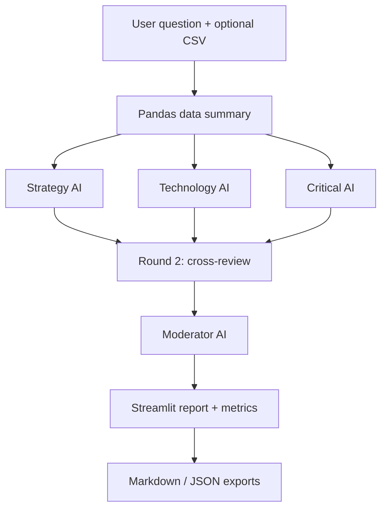

# 🧠 AI Roundtable — Local Multi-Agent Decision Assistant

An end-to-end, **free and local** AI project for exploring business decisions through structured debate. Three AI roles produce independent analyses, review each other's arguments, and a moderator synthesizes the results. Optionally, upload a CSV to ground the discussion in descriptive statistics.

**No paid API, API key, hosted inference, or cloud account required.** The model runs locally using Ollama.

## What it demonstrates

- **AI orchestration:** sequential multi-agent workflows (7 model calls per session)
- **Prompt engineering:** specialised roles, critique round, evidence-aware synthesis
- **Business analytics:** CSV inspection, summary statistics and business recommendations
- **AI observability:** generation times, prompt/output token counts, JSON export
- **Software engineering:** modular Python code, dependency management and unit tests

## Architecture



All model inference is made locally with `ollama.chat()`; all agents share the same local model, with different system instructions. Agents are not independent neural networks.

## Requirements

- Windows 10/11 (or another Ollama-supported OS)
- Python 3.11–3.15 (Python 3.12 is a good choice)
- Ollama (https://ollama.com/download)
- Suggested: 16 GB RAM and available storage space
- A local model: `qwen3:4b-instruct` (~2.5 GB download)

## Quick start (Windows PowerShell in VS Code)

1. Install Python and Ollama.
2. Download the local model:

```powershell
ollama pull qwen3:4b-instruct
```

3. Open this folder in VS Code and run:

```powershell
py -m venv .venv
.\.venv\Scripts\python.exe -m pip install -r requirements.txt
.\.venv\Scripts\python.exe -m streamlit run app.py
```

4. Open the local URL shown in the terminal (typically http://localhost:8501).
5. Ask a business question. Try uploading `dados/exemplo_vendas.csv`.

If the machine is slow, download `ollama pull qwen2.5:1.5b-instruct` and select it from the Streamlit sidebar. Smaller models generally produce less reliable answers.

## Testing

```powershell
.\.venv\Scripts\python.exe -m unittest discover -s tests -v
```

The unit tests mock model calls; they run without a running Ollama server.

## Repo structure

- `app.py` — Streamlit interface, metrics, downloads
- `roundtable.py` — agent definitions, Ollama calls, debate rounds
- `data_utils.py` — CSV statistics and evidence context
- `dados/exemplo_vendas.csv` — synthetic demo data, not real company data
- `tests/test_roundtable.py` — deterministic unit tests
- `GUIA_PT.md` — full Portuguese setup guide

## Limitations

- Agreement between AI agents is **not evidence of correctness**.
- Using distinct prompts with the same model does not guarantee independent views.
- CSV integration provides summaries and a small sample, **not** an exhaustive analysis of every row.
- Small local models can hallucinate; verify critical business claims against evidence.
- This local demo is not an always-on cloud-hosted website; GitHub hosts the code, not the running Ollama service.

## Next ideas

Introduce evidence retrieval and citations (RAG), compare model families, evaluate outputs against labelled cases, add safety checks, and support more structured data analysis.

## External libraries and models

Dependencies and the selected model have their own licenses; verify these before distributing model weights or using the project commercially. Model weights are **not included** in this repository.
